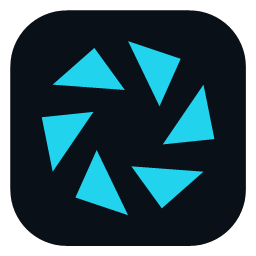

<table align="center">
  <tr>
    <td valign="middle" width="88">
      
    </td>
    <td valign="middle">
      
    </td>
  </tr>
</table>

<p align="center">
  <a href="https://dotnet.microsoft.com/"></a>
  <a href="https://github.com/qiz7z/QSrcRecorder/releases"></a>
  <a href="LICENSE"></a>
  <a href="https://github.com/qiz7z/QSrcRecorder/releases/tag/v0.3"></a>
</p>

<p align="center">
  Windows 上的轻量录屏工具。<br>
  下载即用，一键开录，把讲解和演示留成清楚的视频。
</p>

图标来自 `src/ScreenRecorder/Assets/QSrcRecorder.ico`。仓库暂无 GitHub Actions，因此没有构建状态徽章。

## 功能

<table>
  <tr>
    <td width="50%" valign="top">

### 🎬 多种编码

输出 H.264 MP4。优先 NVENC、Intel Quick Sync 或 AMD AMF，硬件编码不可用时自动改用 libx264。

    </td>
    <td width="50%" valign="top">

### 🎙️ 声音分开录

系统声音和麦克风各自采集，音量可以分别调节。

    </td>
  </tr>
  <tr>
    <td width="50%" valign="top">

### 📷 摄像头画中画

拖动预览窗口改位置，拖四边或四角改大小。成片按这个位置和大小叠加。

    </td>
    <td width="50%" valign="top">

### ✨ 点击高亮

鼠标点击带颜色高亮，演示时更容易看清点了哪里。

    </td>
  </tr>
  <tr>
    <td width="50%" valign="top">

### 🖥️ 三种范围

全屏、框选区域，或指定一个窗口。

    </td>
    <td width="50%" valign="top">

### 🧭 多显示器

录制来源列出已连接的显示器，选择其中一块来录。

    </td>
  </tr>
</table>

定时停止和录制倒计时还没有放进当前版本。

## 为什么选 QSrcRecorder

| | 常见做法 | QSrcRecorder |
| --- | --- | --- |
| 安装 | 先装运行时或整套套件 | 自包含单文件，不用安装 .NET 8 |
| 体积感 | 功能堆在一起，界面很重 | 960×540 的一屏设置，打开就能录 |
| 声音 | 系统声和人声混在一条里 | 系统声、麦克风分开录，音量各自可调 |
| 人像 | 位置和大小只有固定档位 | 预览窗口自由拖动、自由缩放 |
| 画质 | 只绑一种编码器 | NVENC / Quick Sync / AMF，失败再退回 libx264 |

界面是深色科技风星空背景。中文使用华文中宋，英文和数字使用 Times New Roman，标题栏名称使用华文隶书。

界面截图待补。`docs/screenshot.png` 仍是旧图标稿，不是当前界面。

## 使用方法

1. 从 [v0.3 Release](https://github.com/qiz7z/QSrcRecorder/releases/tag/v0.3) 下载 `QSrcRecorder.exe`。大约 174 MB，不需要安装 .NET 8。
2. 把 `ffmpeg.exe` 和 `ffprobe.exe` 放在同一个目录。发布附件里没有这两个文件。
3. 双击运行，或在该目录执行：

```powershell
.\QSrcRecorder.exe
```

目录看起来是这样：

```text
QSrcRecorder/
├── QSrcRecorder.exe
├── ffmpeg.exe
└── ffprobe.exe
```

系统需要 64 位 Windows 10（1903 或更高）或 Windows 11，以及支持 DirectX 11 的显卡。F9 开始或停止，F10 暂停或继续。

## 从源码构建

需要 .NET 8 SDK，并且 `tools/ffmpeg/` 里已有 `ffmpeg.exe` 和 `ffprobe.exe`。发布时会把它们复制到输出目录，不会打进 exe。

```bash
git clone https://github.com/qiz7z/QSrcRecorder.git
cd QSrcRecorder
dotnet publish src/ScreenRecorder -c Release
```

产物在 `src/ScreenRecorder/bin/Release/net8.0-windows10.0.22000.0/win-x64/publish/`。本地调试：

```bash
dotnet run --project src/ScreenRecorder
```

## 许可证

[MIT License](LICENSE)。Copyright (c) 2026 qiz7z。

---

如果 QSrcRecorder 帮到了你，欢迎给仓库点一颗 Star。

发现问题或有想法，请开 [Issue](https://github.com/qiz7z/QSrcRecorder/issues)。改动欢迎 Pull Request：从 `main` 拉分支，改完再提回来。
