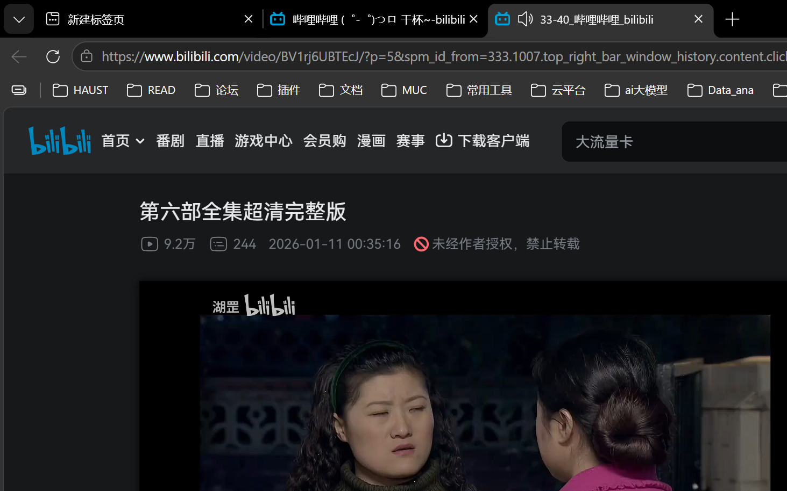

# QSrcRecorder

<!-- <p align="center">
  
</p> -->

<p align="center">
  <strong>一个 Windows 轻量级录屏工具</strong><br/>
  自包含单文件 · 摄像头画中画 · 多声道音频 · 音效调节
</p>

---

## 简介

**QSrcRecorder** 是一款面向 Windows 的轻量级屏幕录制工具，专注于：

- **简洁易用** — 自包含单文件，约 174 MB，无需安装 .NET 8 运行时
- **高质量录制** — 硬件编码 + 软件兜底，稳定高效
- **多功能音频** — 系统声音 / 麦克风独立录制，支持音效调节
- **摄像头画中画** — 预览窗口可自由拖动、缩放，成片按该位置和大小叠加

### 适用场景

| 场景 | 说明 |
|------|------|
| 在线教学 | 摄像头 + 屏幕同步录制 |
| 游戏录制 | 低延迟、高帧率 |
| 软件演示 | 窗口/区域精准录制 |
| 会议记录 | 系统声音 + 人声双通道 |

---

## 功能特性

### 核心功能

| 功能 | 状态 | 说明 |
|------|------|------|
| 全屏录制 | ✅ | 捕获所选显示器 |
| 选择显示器 | ✅ | 录制来源列出已连接的显示器，录制其中一块 |
| 区域录制 | ✅ | 在所选显示器上框选区域录制 |
| 窗口录制 | ✅ | 指定应用窗口录制 |
| H.264 MP4 输出 | ✅ | faststart 优化，支持流式播放 |
| 硬件编码 | ✅ | NVENC / QuickSync / AMF 自动选择 |
| 软件编码兜底 | ✅ | 硬编失败时自动切换 libx264 |
| 帧率可选 | ✅ | 24 / 30 / 60 fps |
| 画质调节 | ✅ | 高 / 中 / 低 三档 |
| 分辨率缩放 | ✅ | 100% / 75% / 50%，降低带宽 |

### 音频功能

| 功能 | 状态 | 说明 |
|------|------|------|
| 系统声音录制 | ✅ | WASAPI Loopback，无需虚拟声卡 |
| 麦克风录制 | ✅ | WASAPI Capture，设备原生格式 |
| 独立音量调节 | ✅ | 麦克风 / 系统声音分别控制 |
| 降噪门 | ✅ | 过滤环境底噪 |
| 低音 / 高音 | ✅ | 系统声音频响调节 |
| 音频合成 | ✅ | 录制结束后 ffmpeg 合并 |

### 增强功能

| 功能 | 状态 | 说明 |
|------|------|------|
| 摄像头画中画 | ✅ | 勾选后拖动预览窗口改位置，拖四边或四角改大小 |
| 鼠标点击高亮 | ✅ | 光圈动画，颜色可自定义 |
| 鼠标跟随圆 | ✅ | 常驻高亮，提升演示效果 |
| 快捷键支持 | ✅ | F9 开始/停止，F10 暂停/继续 |
| 录制悬浮条 | ✅ | 显示时长，可隐藏收进托盘 |
| 设置持久化 | ✅ | 自动保存所有配置 |

### 界面

- 深色科技风，星空背景，半透明面板
- 窗口 960×540（16:9）
- 正文：中文华文中宋，英文和数字 Times New Roman
- 标题栏名称使用华文隶书
- 任务栏图标：深色底、青色六瓣光圈

### 尚未实现

| 功能 | 计划版本 |
|------|----------|
| 定时自动停止 | 规划中 |
| 录制倒计时 | 规划中 |
| 摄像头美颜 | v0.4 |
| 录制历史列表 | v1.0 |
| 安装包发布 | v1.0 |

---

## 环境要求

### 运行环境

- **操作系统**：Windows 10 1903+ / Windows 11（x64）
- **运行时**：发布包已包含 .NET 8 桌面运行时，用户不用单独安装
- **同目录文件**：`ffmpeg.exe` 和 `ffprobe.exe` 必须放在 `QSrcRecorder.exe` 旁边，编码和检查成片时使用
- **显卡**：支持 DirectX 11 及以上（硬件编码需要）

### 开发环境

- **.NET 8 SDK** — 用于编译和调试
- **ffmpeg** — 内置于 `tools/ffmpeg/` 目录

---

## 快速开始

### 方式一：直接运行（推荐）

1. 准备三个文件放在同一目录：`QSrcRecorder.exe`（约 174 MB）、`ffmpeg.exe`、`ffprobe.exe`
2. 双击 `QSrcRecorder.exe`。不需要安装 .NET 8 运行时

### 方式二：本地构建

```bash
# 克隆仓库
git clone https://github.com/qiz7z/QSrcRecorder.git
cd QSrcRecorder

# 构建并发布（csproj 已设为 win-x64 自包含单文件）
dotnet publish src/ScreenRecorder -c Release

# 产物目录里会有 QSrcRecorder.exe、ffmpeg.exe、ffprobe.exe
# src/ScreenRecorder/bin/Release/net8.0-windows10.0.22000.0/win-x64/publish/
```

### 方式三：开发调试

```bash
# 直接运行（需要 .NET 8 运行时）
dotnet run --project src/ScreenRecorder

# 运行单元测试
dotnet test src/ScreenRecorder.Tests

# 端到端冒烟测试
dotnet run --project src/ScreenRecorder.Smoke -c Release
```

---

## 快捷键

| 快捷键 | 功能 |
|--------|------|
| `F9` | 开始 / 停止录制 |
| `F10` | 暂停 / 继续录制 |

---

## 架构设计

```
UI 层 (WPF) → 会话控制层 → 采集引擎 + 音频捕获 → 编码器
```

**模块说明：**

| 模块 | 职责 |
|------|------|
| UI 层 | 参数配置、摄像头设置、音效面板、点击高亮 |
| 会话控制 | 录制生命周期管理、选项解析、结果处理 |
| 采集引擎 | WGC 屏幕采集 (D3D11) |
| 音频捕获 | WASAPI 麦克风 + 系统声音 |
| 编码器 | ffmpeg (NVENC/QSV/AMF/libx264) |

### 关键设计决策

1. **软件合帧** — 摄像头 / 点击高亮直接绘制到帧缓冲，不依赖屏上覆盖层，确保窗口模式也能生效
2. **双缓冲队列** — 采集线程与编码线程分离，避免丢帧
3. **硬编兜底** — NVENC 失败时自动切换 libx264，保证录制成功率
4. **WASAPI 原生** — 麦克风使用设备原生格式，避免 WinMM 立体声兼容问题

---

## 技术栈

| 层级 | 技术 |
|------|------|
| UI | WPF + WinForms 混合 |
| 采集 | Windows Graphics Capture (WGC) |
| 编码 | ffmpeg (NVENC / QSV / AMF / libx264) |
| 音频 | NAudio (WASAPI) |
| 互操作 | CsWin32 (D3D11 / WinRT) |
| 测试 | xUnit |

---

## 已知限制

- DRM 保护内容（Netflix 等）会录制为黑屏，属系统限制
- Windows 10 21H1 及更早版本会出现黄色窗口边框
- 区域选择仅支持单显示器
- 暂停期间不支持插入定格画面
- 录制悬浮条默认显示在右下角，无法自定义位置

---

## 路线图

| 版本 | 状态 | 功能 |
|------|------|------|
| v0.2 | ✅ 已完成 | 多声道音频、摄像头画中画、音效调节、点击/鼠标高亮 |
| 当前界面 | ✅ 已完成 | 深色星空 960×540、华文中宋 / Times New Roman / 标题栏华文隶书、光圈图标、画中画自由拖动与缩放、选择显示器、自包含单文件发布 |
| 后续 | 🚧 规划中 | 定时自动停止、录制倒计时 |
| v1.0 | 📋 规划中 | 安装包发布、录制历史列表、性能优化 |

---

## 项目结构

```
QSrcRecorder/
├── src/
│   ├── ScreenRecorder/          # 主程序
│   │   ├── Assets/              # 图标资源
│   │   ├── Audio/               # 音频捕获 (WASAPI)
│   │   ├── Capture/             # 屏幕采集 (WGC + D3D11)
│   │   ├── Encoding/            # 编码器 (ffmpeg)
│   │   ├── Interop/             # Win32 / WinRT 互操作
│   │   ├── Overlays/            # 覆盖层 (悬浮条、点击高亮、画中画)
│   │   ├── Settings/            # 配置持久化
│   │   └── UI/Wpf/              # WPF 主界面
│   ├── ScreenRecorder.Tests/    # 单元测试
│   └── ScreenRecorder.Smoke/    # 冒烟测试
├── tools/
│   ├── ffmpeg/                  # 内置 ffmpeg
│   ├── IconGen/                 # 应用图标生成
│   └── BgGen/                   # 星空背景生成
├── docs/
│   └── design-system.md         # 设计系统文档
└── README.md
```

---

## 贡献指南

欢迎提交 Issue 和 Pull Request！

1. Fork 本仓库
2. 创建特性分支 (`git checkout -b feature/AmazingFeature`)
3. 提交更改 (`git commit -m 'Add some AmazingFeature'`)
4. 推送到分支 (`git push origin feature/AmazingFeature`)
5. 开启 Pull Request

---

## 许可证

本项目采用 [MIT License](LICENSE) 开源。

---

## 致谢

- [ffmpeg](https://ffmpeg.org/) — 强大的音视频处理工具
- [NAudio](https://github.com/naudio/NAudio) — .NET 音频库
- [Windows Graphics Capture](https://learn.microsoft.com/en-us/windows/win32/winprog/using-windows-graphic-capture) — Windows 系统 API
- [ui-ux-pro-max](https://github.com/uiux-pro-max) — UI/UX 设计智能

---

<p align="center">
  <sub>Built with ❤️ by <a href="https://github.com/qiz7z">qiz7z</a></sub>
</p>
